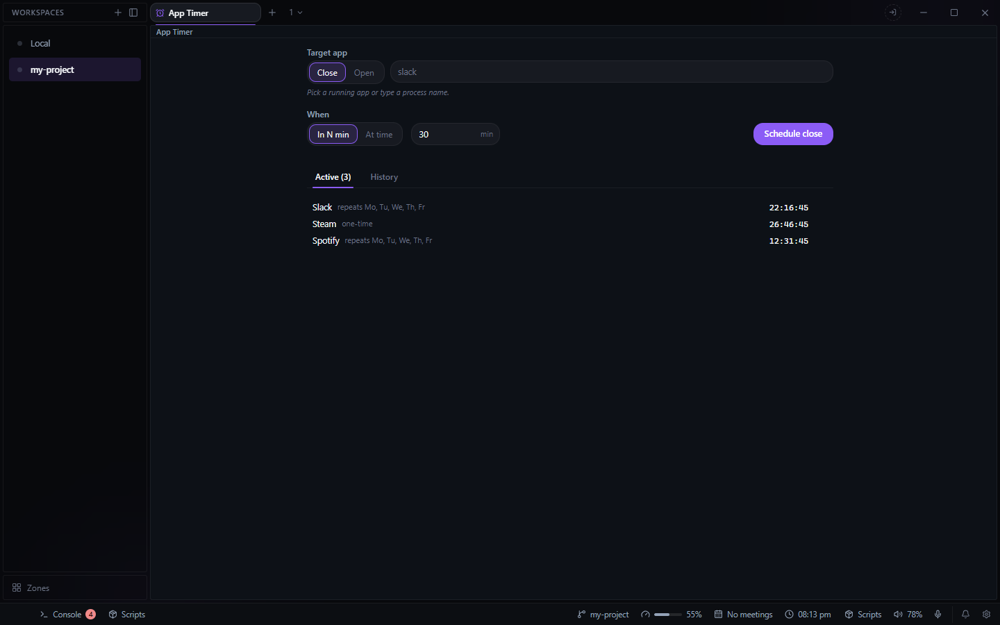

# App Timer for Deck

Close an app, or open one, after a delay or at a time. Open it from the **+** beside your tabs and
choose **App Timer**.

- **Close** a running app: pick it from the list of running apps, or type its process name.
- **Open** an app: search the installed apps, or browse for an `.exe`.
- **When:** in a number of minutes, or at a time of day.
- **Active** lists the timers waiting, each with its countdown and a button to cancel it.
- **History** lists the timers that fired, with **Repeat**, **Remove** and **Clear all**. It is
  shared with Power Timer and keeps the last 50.

Deck's background scheduler fires the timers, so they fire with the tab closed or Deck's window
hidden, as long as Deck is running. Timers are kept in Deck's config as `data/app-timer/app-closer`,
and fired ones in the shared `data/deck/history`.

## The warning

Before a timer fires, Deck warns you. As a notification it has **Cancel timer**; with the tab open,
a dialog also offers **Cancel**, **Do it now**, and **Dismiss**, which leaves the timer to fire on
schedule. In Settings > Plugin settings > App Timer, choose how (a notification, Deck's window
brought to the front, or none) and how many minutes before (1 to 15). Both are kept in Deck's own
settings and apply to Power Timer as well.

## For agents

The plugin brings `deck_add_app_timer` and `deck_cancel_app_timer` to Deck's MCP server. An agent
can close an app after a number of minutes or at a time, including at a time on chosen days of the
week, every week. `deck_list` shows each timer with the id that cancels it.
